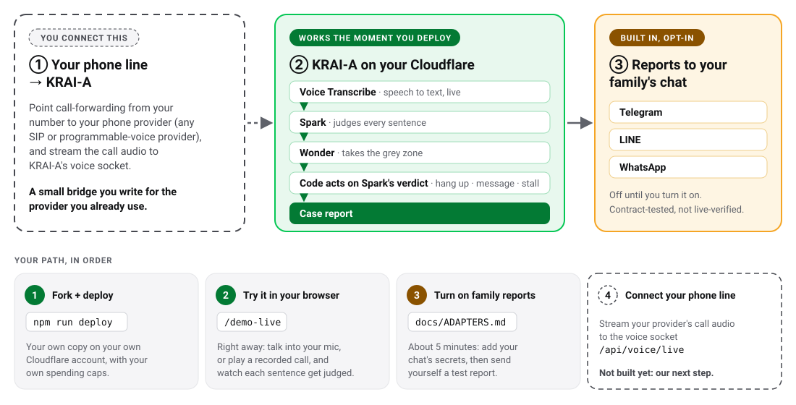

# KRAI-A beta: an AI receptionist that screens scam calls

**Live:** https://beta.krai-a.com · **Try a call:** https://beta.krai-a.com/demo-live ·
**Measured results:** https://beta.krai-a.com/proof · License: MIT

**Demo video:** (link added at submission)

> KRAI-A is an independent project. Not affiliated with or endorsed by Meta.
> Meta and Muse are trademarks of their respective owners.

Solo Indie-track entry, built for the Meta Global AI Developer Hackathon
(Nov 2026). This hackathon entry (beta) is MIT open source: the Muse pipeline,
the training arena and every test result.

**They don't pick an age. They pick whoever picks up.** So KRAI-A picks up
instead. It answers unknown calls for the people you love and says up front
that it is automated. It listens and answers in the caller's language (Thai,
English or Mandarin) and judges every caller sentence as it is spoken. It
hangs up on scammers, takes a message otherwise, and ends with a case report
the family can copy or share.

## The problem

- **Nov 2, 2026, Bangkok:** a 19-year-old university student got a call
  saying her number was used to promote online gambling. The call was passed
  to a fake "officer" on a LINE video call. She lost about ฿400,000: three
  transfers plus cash handed to a courier.
  ([Thairath, Nov 3, 2026](https://www.thairath.co.th/news/crime/2970050))
- **Worldwide:** 57% of adults met a scam in the past 12 months, and 23% lost
  money, in a survey of 46,000 adults in 42 markets.
  ([GASA × Feedzai, Global State of Scams 2025](https://gasa.org/knowledge-base/blog/global-scams-on-the-rise-over-half-of-adults-worldwide-report-scam-encounters))
- **Our reasoning, not a statistic:** gangs switch numbers, so a blocklist
  misses the first call from a new number. The script is what gives them
  away.

## Why not a blocklist or a call screener?

> Blocklists know numbers. Call screeners hand the decision back to you.
> KRAI-A judges the script and hangs up itself — and every number behind that
> is on /proof, misses included.

> Screeners protect you and let you decide. KRAI-A protects someone you love —
> the person who decides worst under pressure — and tells you afterwards.

Examples of call screeners, per their public descriptions, Nov 2026: Truecaller
Assistant, Pixel Call Screen, iOS call screening, Whoscall.

| Claim | Evidence | Limit |
|---|---|---|
| Hangs up itself without cutting off real callers | 0/116 real callers judged scam across 4 sealed sets (v1 0/10, v2 0/26, intl 0/62, v4 0/18); Muse Spark decides the verdict; a fixed rule in code (`policy.js`) turns it into the action (e.g. SCAM ≥ 0.85 → hang up). [/proof](https://beta.krai-a.com/proof) | 116 is small, and the calls are synthetic |
| Measured in a way it can't fool itself | Sealed sets are hash-pre-registered in git and run once per build. Misses are published: on the stress set, B30 blocked 31/59, held 24 as a message and let 4 through as LEGIT; Malay 0/4, Tagalog 0/6. A second-family labeller audit gave kappa 0.975 on train. [/proof?set=sealedV4](https://beta.krai-a.com/proof?set=sealedV4) | the stress set ran on 100 of 236 calls |
| A training loop that compounds | The AI-vs-AI arena ran 504 games: 1 of 185 real callers wrongly hung up, holdout after fixes 0/57. Sealed v2 60/60 (34/34 scams); sealed-intl 57/59 scams in 9 languages with 0/62 real callers judged scam. [/arena](https://beta.krai-a.com/arena.html) | the data is AI-written, with no real victim calls yet |
| The output is evidence, not a warning | Every call ends with a structured report for the family: who the caller claimed to be, the tactic, and the account numbers, LINE IDs and links the caller gave, in their own words (links defanged). [/demo-live](https://beta.krai-a.com/demo-live) | chat delivery is contract-tested, not live-verified |
| Cost and speed are measured | $0.0081 per call ($8.14 per 1,000); judging takes 2.5 s p50 per sentence; a daily cap and a kill switch are in place. [/proof](https://beta.krai-a.com/proof) | slower than the old build (0.27 s) |

Better than before (real audio, 10 calls, TTS voices): scams flagged 6/6 vs
1/6 for the old build, with 0 wrong hang-ups. The longest silence in a call
went from 4.4 s to ≤0.74 s.

## Who it covers

| | |
|---|---|
| **Languages today** | Thai ✓ · English ✓ · Mandarin ✓ (judged, and answered in the caller's language) |
| **Next on our roadmap** | Southeast Asian languages: Vietnamese, Indonesian, Malay, Tagalog (judged today; replies in English) |
| **Who it protects** | Whoever picks up: students · office workers · business owners · older parents |

Characters are fictional, inspired by real cases reported in Thai news, Nov 2026.

## How it works

Hear it. Judge every sentence. Act by rule. Report to the family.

Muse Spark decides the verdict; a fixed rule in code (`policy.js`) turns it
into the action (e.g. SCAM ≥ 0.85 → hang up).

```mermaid
flowchart LR
  subgraph RUN["1 · During a call"]
    direction LR
    A["Incoming call"] --> B["Muse Voice Transcribe 1.0<br/>realtime speech → text via a Durable Object;<br/>key stays server-side"]
    B --> C["T1 code rules<br/>hard demands: OTP · app install · transfer now"]
    C --> D["Muse Spark 1.2<br/>every caller sentence → strict JSON:<br/>verdict, tactic, 9 risk signals"]
    D -- "grey zone only" --> E["Muse Wonder 1.0<br/>second opinion, 6% of sentences"]
    D --> F["policy.js: acts on Spark's verdict<br/>(fixed rule, e.g. SCAM ≥ 0.85 → hang up)<br/>hang up · take a message · trap (stall)"]
    E --> F
    F --> G["Muse Spark 1.3<br/>writes the trap lines + the case report"]
    G --> H["Family<br/>copy/share · forks: Telegram / LINE / WhatsApp"]
    V["Voice out: fixed lines pre-recorded;<br/>live lines via Gemini TTS, which decides nothing"] -.- F
  end
  subgraph LOOP["2 · How it improves"]
    direction LR
    L1["Muse Wonder plays adaptive scammers<br/>AI-vs-AI arena, 504 games"] --> L2["Misses fixed on train data only"]
    L2 --> L3["Sealed sets<br/>hash-pre-registered, run once"]
    L3 --> L4["/proof<br/>misses included"]
    L4 -- "back to the arena" --> L1
  end
  RUN ~~~ LOOP
```



## Which Meta model does what

| Model | Job |
|---|---|
| **Muse Voice Transcribe 1.0** | The ear: realtime transcription through a Durable Object, so the key stays server-side. Final text arrives ~1.8 s after speech ends. |
| **Muse Spark 1.2** (effort minimal) | Judges every caller sentence as strict JSON (verdict, tactic, 9 risk signals). 2.5 s p50, $0.0081 per call. |
| **Muse Wonder 1.0** | A second opinion on grey-zone sentences only (16 of 267, 6%, on sealed-intl). It also plays adaptive scammers in the AI-vs-AI arena. |
| **Muse Spark 1.3** | Writes trap-mode stalling lines and the end-of-call case report. |
| code (`policy.js`) | Acts on Spark's verdict with a fixed rule (e.g. SCAM ≥ 0.85 → hang up). It never closes a non-scam call before turn 4. |
| Gemini TTS (not Meta) | Speaks the lines our server wrote and decides nothing. The Meta Model API has no TTS. |

## Scope and honest limits

- **Today:** try a call in your browser (your mic, or play a recorded call).
  Fork it and deploy your own. Send case reports to your family's Telegram,
  LINE or WhatsApp (opt-in; contract-tested, not live-verified).
- **Next:** a real phone line through call forwarding (not built).
- On the stress set, 4 scams slipped through as real callers, and Malay
  (0/4) and Tagalog (0/6) are the weakest languages.
- The test data is AI-written and synthetic; there are no real victim calls
  yet.
- Judging is slower than the old build: 2.5 s vs 0.27 s per sentence.
- After the sealed runs, the receptionist's wording changed, and the T1 code
  rules stopped treating call-routing phrases as transfer demands. The Spark
  and Wonder prompts and the verdict policy are unchanged, and the sealed
  sets were not re-run (see [`BUILD-LOG.md`](BUILD-LOG.md)).

## Fork it: plug in your family's chat

1. **Works the moment you deploy:** the whole judging side runs on your own
   Cloudflare account.
2. **Try it in your browser** at `/demo-live` the same day (mic, or play a
   recorded call).
3. **Opt-in family reports** to Telegram, LINE or WhatsApp (contract-tested,
   not live-verified).
4. **You connect your phone line:** a small bridge from your phone provider
   to KRAI-A's voice socket. Not built yet; it is our next step too.

It is a web demo, not a phone line, today. Full guide:
[`docs/FORK.md`](docs/FORK.md).



When a call ends, the case report can be sent to Telegram, LINE (Messaging
API) or WhatsApp (Cloud API).

- **Opt-in and safe by default:** it is off unless `NOTIFY_ENABLED=1` and that
  channel's secrets are set. Caller links are defanged, and every message
  says it comes from an AI assistant.
- **Setup:** follow [`docs/ADAPTERS.md`](docs/ADAPTERS.md), then
  `npm run notify:test -- --channel telegram` sends a sample to your own chat.
- **Status:** contract-tested against the documented APIs, not live-verified.
  The public demo has delivery off.

## AI disclosure and privacy

- **Disclosure:** every call opens with "an automated assistant is answering
  for the owner; this call is recorded". A code guard replaces any generated
  line that claims to be a person.
- **Audio:** it is streamed to the Meta Model API for transcription and
  processed under Meta's API terms. We don't store audio.
- **Call text:** it is kept server-side only during the call and deleted when
  the caller hangs up (at most 15 minutes later), with no outside read path.
- **Visitors:** no accounts and no phone numbers. IPs are kept only as salted
  hashes for rate limits. The model API key never reaches the browser.

**Voice output only: Gemini TTS, because Meta's Model API has no TTS; Muse
Spark decides; a fixed rule in code acts on it.**

## What's new in this hackathon

The same brand, KRAI-A, has an older build that was entered in the **Google
Cloud AI Builder Cup** (Oct 7–18, 2026). That build is **not part of this
entry**. This repo was started after the Meta kickoff; its first commit is
`323e625` (Oct 27, 02:04 Thai time). Day-by-day evidence is in
[`BUILD-LOG.md`](BUILD-LOG.md).

| | Old build (not part of this entry) | This entry (built Oct 27 – Nov 4) | Carried over, used only as … |
|---|---|---|---|
| Speech | Gemini Live | Muse Voice Transcribe, realtime socket through a Durable Object (`app/src/voice*.js`) | — |
| Scam judge | Jev + Gemini escalation | Muse Spark on every turn, Muse Wonder for the grey zone, code policy (`spark.js`, `wonder.js`, `policy.js`) | the old judge, copied verbatim into `app/src/baseline/`, **used only as the ruler** by `scripts/eval.mjs`. No live code imports it. |
| Delivery to the family | call forwarding + LINE delivery | a web demo; the family copies or shares the case report. Forks can opt in to Telegram, LINE or WhatsApp delivery (`app/src/notify/`, contract-tested, not live-verified). | — |
| Disclosure opener | — | every call opens by saying it is an automated assistant and that the call is recorded | — |
| Trap mode | — | new (`trap.js`, `routes-wonder.js`) | — |
| Case report at call end | — | new (`report.js`, `public/report-card.js`) | — |
| Spend guard (session, rate limits, daily cap, kill switch) | — | new (`abuse.js`, `budget.js`) | — |
| Sealed sets + /proof | — | new | — |
| Train corpus | some train calls | new train calls and every sealed call | the ported calls (`"source": "v2-port"`) are **train data only**, never sealed |

"—" means nothing was carried over for that row; this entry's version is new
code.

## For judges

- **Try it:** [docs/judge-guide.md](docs/judge-guide.md), or open
  https://beta.krai-a.com/demo-live and play a recorded call or be the scammer.
- **Submission write-up:** [docs/SUBMISSION.md](docs/SUBMISSION.md)
- **Architecture:** [docs/architecture.svg](docs/architecture.svg)
- **Measured numbers, every sealed set side by side:** https://beta.krai-a.com/proof
- **Day-by-day build log, including every dated measurement:** [BUILD-LOG.md](BUILD-LOG.md)

## Quickstart

```bash
cd app
cp .dev.vars.example .dev.vars   # fill META_MODEL_API_KEY (gitignored)
npm install
npm run dev                      # http://localhost:8787
```

## Deploy

```bash
cd app
npx wrangler secret put META_MODEL_API_KEY   # production key, never in repo
npm run deploy
```

Live: https://beta.krai-a.com · Health: https://beta.krai-a.com/api/health

## Layout

```text
app/
  src/index.js        Worker entry (Hono, /api/* only; / serves static)
  src/voice.js        Meta Voice protocol: handshake, events, TurnAssembler, relay
  src/voice-do.js     VoiceCall Durable Object (Hibernation relay shell)
  src/spark.js        Spark few-shot verdict client (cached, never throws)
  src/policy.js       3-tier policy: the ONLY place verdicts become action
  src/trap.js         disclosure line, trap mode (plays for time), intel extraction
  src/report.js       case report at call end (POST /api/report)
  src/baseline/       old Google-Cloud judge, frozen: eval ruler only, never imported by live code
  public/             static demo pages (served by Cloudflare Static Assets)
  test/               node:test suites (npm test)
  wrangler.jsonc      Worker config (SORNKan account, beta.krai-a.com)
  .dev.vars.example   local secret template (copy to .dev.vars, gitignored)
docs/
  demo-live.md        realtime voice demo: wire-up, rules, failure modes
scripts/
  check-public.js     CI gate: no secrets tracked, env files gitignored
```

## Rules we build by

- Meta Model API key stays server-side; the browser never sees it.
- Muse Spark decides the verdict; a fixed rule in code acts on it.
- Every number on `/proof` is measured, with the baseline beside it where it was run.

## Links

- Event: https://cerebralvalley.ai/e/meta-ai-developer-hackathon
- Meta Model API docs: https://dev.meta.ai/docs/overview

## License

MIT — see [LICENSE](LICENSE).

KRAI-A is an independent project. Not affiliated with or endorsed by Meta.
Meta and Muse are trademarks of their respective owners. Built for the Meta
Global AI Developer Hackathon, Nov 2026.
